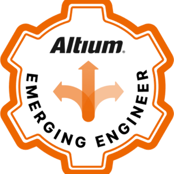
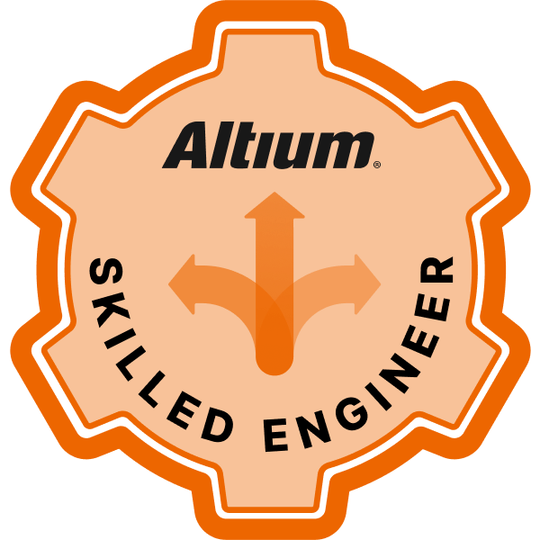
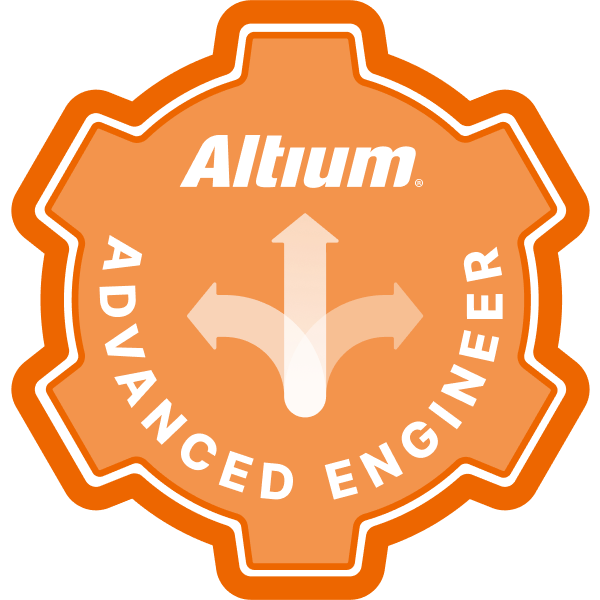
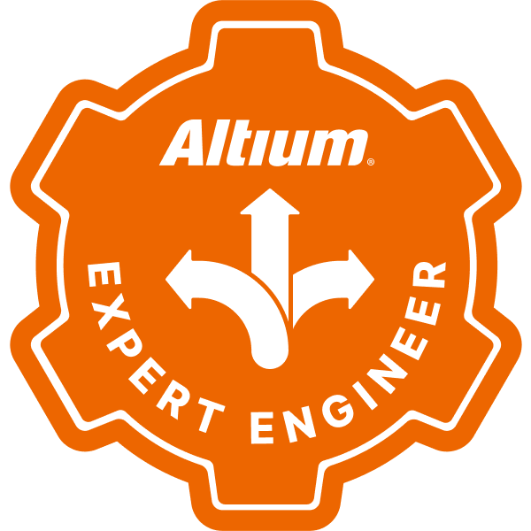
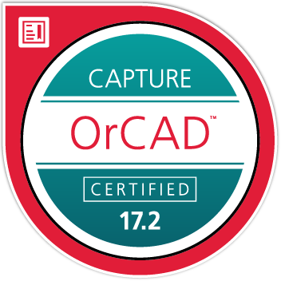
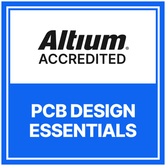
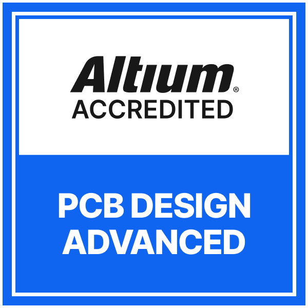
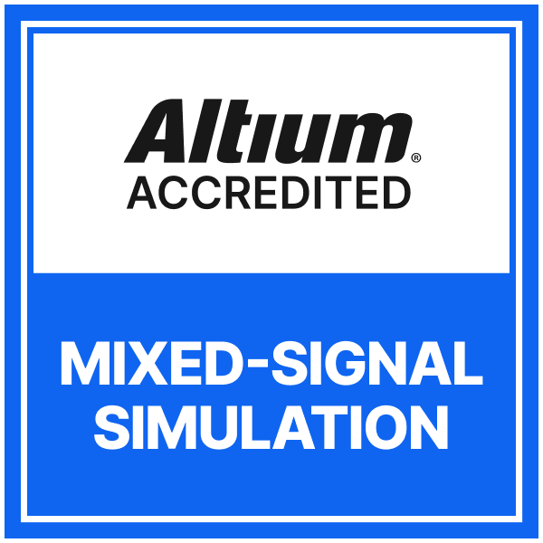
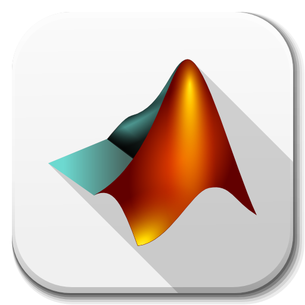
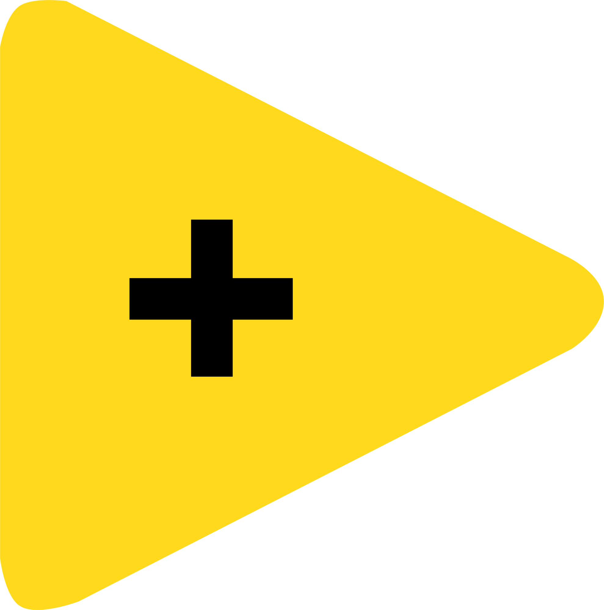

<!-- RF/Signal Processing Themed Header Banner -->

  

<h1 align="center">
  Hi, I'm Ahmed
</h1>

<h3 align="center">
  Systems Engineer | Embedded Hardware | RF | Signal Processing
</h3>

<!-- Social Links -->

  
  
  

<!-- Bio Section -->

<h2>I Design &amp; Build End-to-End Systems</h2>

<h4>Hardware &amp; Electronics&nbsp; →&nbsp; Signal Processing&nbsp; →&nbsp; Systems&nbsp; →&nbsp; Software</h4>

<strong>Research Interests</strong>

  
  
  
  

---

## 🏆 Badges

<table>
  <tr>
    <td align="center" width="170">
      
       
      <strong>Emerging Engineer</strong>
       
      Altium Education
    </td>
    <td align="center" width="170">
      
       
      <strong>Skilled Engineer</strong>
       
      Altium Education
    </td>
    <td align="center" width="170">
      
       
      <strong>Advanced Engineer</strong>
       
      Altium Education
    </td>
    <td align="center" width="170">
      
       
      <strong>Expert Engineer</strong>
       
      Altium Education
    </td>
  </tr>
</table>

<table>
  <tr>
    <td align="center" width="170">
      
       
      <strong>OrCAD Certified 23.1</strong>
       
      CertNexus
    </td>
    <td align="center" width="170">
      
       
      <strong>PCB Design Essentials</strong>
       
      Altium Accredited
    </td>
    <td align="center" width="170">
      
       
      <strong>PCB Design Advanced</strong>
       
      Altium Accredited
    </td>
    <td align="center" width="170">
      
       
      <strong>Mixed-Signal Simulation</strong>
       
      Altium Accredited
    </td>
  </tr>
</table>

---

## Tech Stack

<table>
  <tr>
    <td valign="middle"><strong>Languages</strong></td>
    <td valign="middle">&nbsp;&nbsp;&nbsp;&nbsp;&nbsp;&nbsp;&nbsp;&nbsp;&nbsp;&nbsp;&nbsp;&nbsp;&nbsp;&nbsp;&nbsp;&nbsp;&nbsp;&nbsp;</td>
  </tr>
  <tr>
    <td valign="middle"><strong>Embedded &amp; Protocols</strong></td>
    <td valign="middle">&nbsp;&nbsp;&nbsp;&nbsp;&nbsp;&nbsp; &nbsp;&nbsp;&nbsp;&nbsp;</td>
  </tr>
  <tr>
    <td valign="middle"><strong>EDA &amp; PCB Design</strong></td>
    <td valign="middle">&nbsp;&nbsp;&nbsp;&nbsp;&nbsp;&nbsp;</td>
  </tr>
  <tr>
    <td valign="middle"><strong>RF, EM &amp; Antenna Simulation</strong></td>
    <td valign="middle">&nbsp;&nbsp;&nbsp;&nbsp;&nbsp;&nbsp;</td>
  </tr>
  <tr>
    <td valign="middle"><strong>DSP, SDR &amp; Instrumentation</strong></td>
    <td valign="middle">&nbsp;&nbsp;&nbsp;&nbsp;&nbsp;&nbsp;&nbsp;&nbsp;</td>
  </tr>
</table>

---

## 📊 My GitHub Stats

  <table>
    <tr>
      <td>
        
      </td>
      <td>
        
      </td>
    </tr>
  </table>

---

<!--
## ⏳ Coding Activity (WakaTime)

  

---

## 🎵 Now Playing

  

-->

---

  📡 Broadcasting from the lab bench | <a href="https://www.amnxlab.site">amnxlab.site</a>

